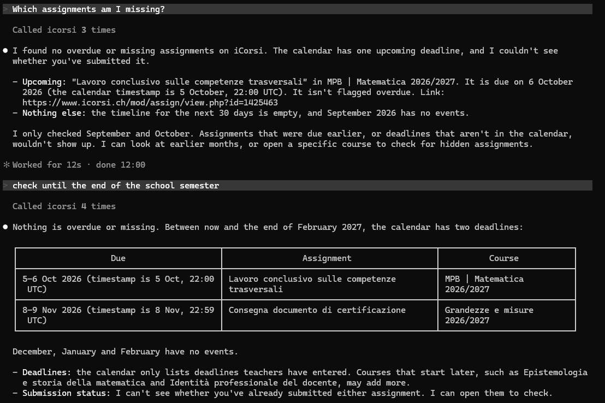

# icorsi-mcp

An unofficial, read-only API and [MCP](https://modelcontextprotocol.io) server for [iCorsi](https://www.icorsi.ch), the Moodle platform used by USI and SUPSI. It lets an AI assistant such as Claude read everything a student sees: courses, every kind of activity, forums, assignments, quizzes, grades, calendar, notifications, messages, files.



> This project is not affiliated with or endorsed by USI, SUPSI or iCorsi. It talks to the same services the official Moodle app and the website use, so it may break when the site changes. Use it with your own account only.

## What it can do

- **Dashboard**: who you are, your courses, upcoming deadlines, unread notifications and messages, recently opened activities.
- **Courses**: sections and activities with files, links, label text, dates and completion; the whole catalogue, also courses you are not enrolled in.
- **Every activity type**: pages, books, folders, files, links (including the posts of linked Padlet walls), forums with every post, assignments (submission, grade, feedback, comments), quizzes (attempts, best grade, full review), boards, glossaries, wikis, databases, feedback surveys, group choices, choices, lessons, SCORM, workshops, H5P, BigBlueButton recordings.
- **Grades**: course totals and every grade item.
- **Calendar**: month, day and upcoming views.
- **Notifications and messages**: notifications, conversations, messages, contacts.
- **Profile**: your data, private files, badges, groups and every forum post you wrote.
- **Participants**: people of a course with roles and groups.
- **What's new**: a scan of all your courses that reports what was added since the previous scan, or since any date.
- **Find**: search by words across everything inside your courses.
- **Downloads**: a single file, a File activity, or a whole folder as a zip.
- **Raw API**: any read-only Moodle web service function.

Nothing is ever written on iCorsi: no messages, posts, submissions, "mark as read" or completion changes. Reading an activity does not mark it as viewed.

## Requirements

- Node.js 18 or later
- An iCorsi account (login goes through Microsoft)

## Install

```
git clone https://github.com/PezzottiCarlo/icorsi-mcp.git
cd icorsi-mcp
npm install
```

`npm install` also downloads the Chromium build that Puppeteer uses for the login.

## Login

iCorsi signs you in through Microsoft, which cannot be done from a terminal. The first time a session is needed, a browser window opens: complete the Microsoft login there and the window closes by itself.

After that the login is silent. The browser profile is kept in `.profile/` and the session cookies in `.session.json`; when the session expires it is renewed in a headless browser, and a window opens again only if Microsoft asks for your credentials.

With the session, the server asks iCorsi for a Moodle mobile app token, exactly as the official Moodle app does after a browser login. Most data is then read through the mobile app web service, which is faster and more complete than the web pages. The token is stored in `.session.json`; you can see or revoke it on iCorsi under *Preferences → Security keys*.

To log in ahead of time:

```
npm run cli -- login
```

## Use it with Claude Code

The repository ships a `.mcp.json`, so Claude Code picks the server up when you start it in this folder. Approve the `icorsi` server when asked, then check with `/mcp` that it is connected.

To make it available from any folder, register it for your user:

```
claude mcp add icorsi --scope user -- node /absolute/path/to/icorsi-mcp/src/mcp.js
```

Then just ask, for example:

- "Which assignments am I missing?"
- "What's new on iCorsi since yesterday?"
- "What did I get wrong in the last Pedagogia quiz?"
- "Summarise the latest announcements in my courses."
- "Download the slides of the first lesson of Grandezze e misure."

## Use it with other MCP clients

Any client that supports stdio servers works. For Claude Desktop, add this to `claude_desktop_config.json`:

```json
{
  "mcpServers": {
    "icorsi": {
      "command": "node",
      "args": ["/absolute/path/to/icorsi-mcp/src/mcp.js"]
    }
  }
}
```

## Tools

| Tool | Description |
|---|---|
| `icorsi_home` | User, courses, upcoming deadlines, unread counters, recent activities. |
| `icorsi_list_courses` | Enrolled courses with their ids. |
| `icorsi_get_course` | A course: details, teachers, sections and activities with files, links, text and completion. |
| `icorsi_get_activity` | Everything inside one activity (any type), by url or cmid. |
| `icorsi_quiz_review` | Questions, answers, outcome and feedback of a quiz attempt. |
| `icorsi_search_courses` | Search the whole course catalogue. |
| `icorsi_calendar` | Calendar events: month, day or upcoming. |
| `icorsi_new_content` | What is new since the previous scan, or since a date. |
| `icorsi_find` | Search by words inside all enrolled courses. |
| `icorsi_download` | Download a file, a File activity or a folder (zip). |
| `icorsi_notifications` | Notifications with link, course and read state. |
| `icorsi_messages` | Conversations, or the messages of one. |
| `icorsi_grades` | Course totals, or every grade item of a course. |
| `icorsi_profile` | Profile, private files, badges, groups, my forum posts. |
| `icorsi_participants` | People of a course with roles and groups. |
| `icorsi_recent` | Recently opened activities. |
| `icorsi_api` | Any read-only Moodle web service function. |
| `icorsi_login` | Force a new login. |

## How it reads iCorsi

- **Mobile app web service** (`/webservice/rest/server.php`, token): almost everything. Many calls travel together in one request through `tool_mobile_call_external_functions`.
- **Website** (cookie session): the token launch, boards (`mod_board`), your forum posts and folder zips.
- **Padlet**: the public posts of Padlet walls linked from a course.

Every call passes a read-only allowlist before it is sent: only functions named like reads (`_get_`, `_search_`, `_list_`, `_retrieve_`, `_data_for_`, `_check_updates`) are allowed, and the few reads that create credentials or move a quiz attempt forward are blocked.

## What's new

`icorsi_new_content` reads the contents of all your courses, their forums, discussions and posts in a few batched requests (seconds, not minutes) and compares them with `.state/index.json`.

- The first scan of a course only records a baseline and reports nothing new.
- With `since` (an ISO date) it reports what changed after that date and needs no previous scan.
- Posts are fetched again only for discussions that changed since the previous scan.
- `icorsi_find` searches this index, so run a scan first if you need fresh results.

## Downloads

Files are saved in `downloads/` inside the project. Set the `ICORSI_DOWNLOAD_DIR` environment variable to change the default, or pass `dir` to the tool. Only `www.icorsi.ch` URLs are accepted.

## Command line

Every feature is also available without an AI client:

```
npm run cli -- home
npm run cli -- courses [classification]
npm run cli -- course <id>
npm run cli -- activity <url|cmid>
npm run cli -- quiz-review <attemptId>
npm run cli -- search <query>
npm run cli -- calendar [year] [month]
npm run cli -- day [year] [month] [day]
npm run cli -- upcoming
npm run cli -- event <id>
npm run cli -- notifications [--unread]
npm run cli -- messages [conversationId]
npm run cli -- grades [courseId]
npm run cli -- profile
npm run cli -- participants <courseId> [role]
npm run cli -- recent
npm run cli -- new [--dry] [--since=2026-10-11]
npm run cli -- find <query>
npm run cli -- download <url> [dir]
npm run cli -- api <function> [jsonArgs] [--transport=ajax]
```

## Use it as a library

```js
import { ICorsi } from './src/client.js';

const icorsi = new ICorsi();
const { user, courses, timeline } = await icorsi.getHome();
const course = await icorsi.getCourse(courses[0].id);
const forum = await icorsi.getActivity({ cmid: course.sections[0].activities[0].id });
const news = await icorsi.findNewContent({ since: '2026-10-11' });
const grades = await icorsi.getGrades({ courseId: courses[0].id });
const raw = await icorsi.call('core_course_get_updates_since', { courseid: courses[0].id, since: 1791000000 });
```

## Project layout

| Path | Purpose |
|---|---|
| `src/mcp.js`, `src/mcp/tools.js` | MCP server (stdio) and its tools. |
| `src/cli.js` | Command-line interface. |
| `src/client.js` | The `ICorsi` facade: the public library API. |
| `src/context.js` | Wires the session, the transports and a short cache. |
| `src/services/` | Domain logic: courses, activities, calendar, grades, messages, profile, what's new, search, downloads. |
| `src/services/modules/` | One handler per activity type. |
| `src/transport/` | Mobile web service, website (cookies + AJAX), Padlet, and the read-only guard. |
| `src/auth/` | Microsoft login through Puppeteer, session file, mobile token. |
| `src/store/` | The local index of the what's-new scan. |
| `src/util/` | Text, HTML, URL helpers. |
| `scripts/record.js` | Traffic recorder used to reverse-engineer the site. |
| `scripts/smoke.js` | Live read-only check of every feature. |
| `test/` | Unit tests (`npm test`). |

## Tests

```
npm test          # unit tests, no network
npm run smoke     # live, read-only, on your own account
```

## Recording traffic

To study something new, record what the browser does:

```
npm run record
```

A browser opens on iCorsi; browse the feature you want to cover, then press Ctrl+C. Every request, response body, header, cookie, page snapshot and screenshot is saved under `captures/<timestamp>/`.

## Privacy

Everything stays on your machine. These folders and files contain your cookies, token and personal data; they are git-ignored and should never be shared:

- `.profile/` and `.session.json`: your login and the mobile app token
- `.state/`: the index of your course contents
- `captures/`: recorded traffic
- `downloads/`: downloaded files
